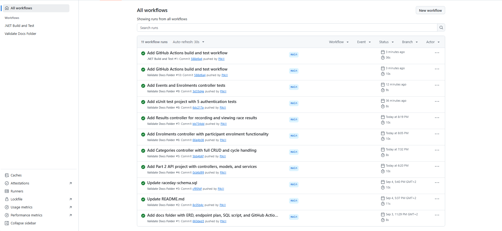

# RaceDay - Event Management System

## System Description
RaceDay is a full-stack platform for managing road running, walking, and cycling events in South Africa. It allows Event Organisers to create and manage events, categories, and results, while Participants can browse events, enrol, and track personal performance.

## User Roles
- **Organiser**: Can create, edit, and delete events, manage categories, capture participant results, and view all event enrolments.
- **Participant**: Can create an account, browse events, enter events by selecting a category, view their own enrolments, and track personal results.

## Technology Stack (Part 2)
- **Backend**: ASP.NET Core Web API (.NET 9)
- **ORM**: Entity Framework Core (Code-First)
- **Database**: SQL Server
- **Authentication**: JWT (JSON Web Tokens)
- **Password Hashing**: BCrypt.Net
- **Documentation**: Swagger (OpenAPI)
- **Testing**: xUnit (14 unit tests)
- **CI/CD**: GitHub Actions

## Setup Instructions
1. Clone this repository.
2. Open `RaceDay.slnx` in Visual Studio.
3. Run the `raceday-schema.sql` script in SQL Server Management Studio (SSMS) to create the database.
4. Update the connection string in `RaceDay.API/appsettings.json` if your SQL Server instance differs.
5. Build the solution (Ctrl+Shift+B).
6. Run the API project (F5).
7. Navigate to `https://localhost:7299/swagger/index.html` to test the endpoints.

## Running Tests

Or run them from Visual Studio's Test Explorer.

## API Endpoints
- **Authentication**: Register, Login
- **Users**: Get/Update Profile
- **Events**: Full CRUD (Organiser only for create/update/delete)
- **Categories**: Full CRUD for events (Organiser only)
- **Enrolments**: Participant enrols, views own enrolments
- **Results**: Organiser records results, Participant views own results

Role-based access is enforced at the API level via `[Authorize(Roles = "...")]`.

## CI/CD Build Status

## Video Presentation
[Watch the Part 2 video here](https://youtu.be/tJjud2T-ChU)

## Development Notes

Part 2 was built incrementally with meaningful commits covering:
- Project setup with EF Core and SQL Server
- JWT authentication and role-based authorization
- Full CRUD controllers for Events, Categories, Enrolments, and Results
- xUnit unit tests covering auth, events, role rejection, and enrolments
- GitHub Actions CI/CD workflow for automated build and test
